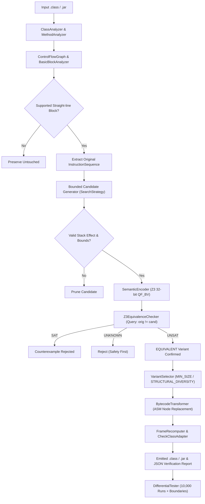

# Implementation Plan: JVM Bytecode Obfuscator via Superoptimization & SMT Verification

## 1. Executive Summary & Vision

This project implements a functional research prototype of a **JVM Bytecode Superoptimizer and Semantic-Preserving Obfuscator**. Traditional obfuscators rely predominantly on syntactic alterations (identifier renaming, dead-code insertion, opaque predicates). In contrast, this system leverages **program equivalence through bounded superoptimization**:
1. Isolating linear basic blocks of straight-line integer bytecode instructions.
2. Generating alternative instruction candidate sequences using bounded combinatorial search and stochastic mutation (STOKE-inspired).
3. Formally proving semantic equivalence using the **Z3 SMT Solver** over 32-bit Bit-Vector (`QF_BV`) arithmetic with exact JVM two's-complement overflow semantics.
4. Rewriting the verified sequences into the target class files using the **ASM Tree API** and recomputing valid StackMapTable frames.
5. Emitting distinct, structurally diverse variants or minimal-size equivalents guided by configurable objectives and deterministic random seeds.
6. Validating equivalence empirically via a differential testing pipeline (10,000+ random inputs + boundary values).

---

## 2. Technology Stack & Dependencies

| Component | Technology | Version | Purpose |
| :--- | :--- | :--- | :--- |
| **Language** | Java (OpenJDK) | 21 LTS | Core implementation platform |
| **Build Tool** | Apache Maven | 3.9.9 | Project lifecycle, dependency management, test execution |
| **Bytecode Framework** | OW2 ASM | 9.7.1 | Class parsing, instruction tree manipulation, stack frame computation |
| **Bytecode Analysis** | ASM Analysis & Util | 9.7.1 | Control-flow graph, frame verification (`CheckClassAdapter`) |
| **SMT Solver** | Z3 (`tools.aqua:z3-turnkey`) | 4.14.1 | Automated theorem proving via 32-bit Bit-Vector logic |
| **Testing Engine** | JUnit Jupiter (JUnit 5) | 5.10.2 | Unit testing, property-based testing, differential testing |
| **Code Coverage** | JaCoCo Maven Plugin | 0.8.12 | Enforcing high test coverage across all subsystems |
| **Reporting / Config** | Jackson Databind | 2.17.2 | Machine-readable JSON configuration and benchmark reporting |
| **Version Control** | Git | 2.53+ | Incremental commit tracking per phase |

---

## 3. Architecture & Package Structure

```
jvm-superoptimizer/
├── pom.xml
├── README.md
├── .gitignore
├── LICENSE
│
├── src/
│   ├── main/
│   │   └── java/
│   │       └── com/superopt/
│   │           ├── Main.java
│   │           │
│   │           ├── cli/
│   │           │   ├── CommandParser.java
│   │           │   └── CliOptions.java
│   │           │
│   │           ├── analysis/
│   │           │   ├── ClassAnalyzer.java
│   │           │   ├── MethodAnalyzer.java
│   │           │   ├── BasicBlockAnalyzer.java
│   │           │   ├── ControlFlowGraph.java
│   │           │   └── InstructionInfo.java
│   │           │
│   │           ├── model/
│   │           │   ├── BasicBlock.java
│   │           │   ├── InstructionSequence.java
│   │           │   ├── StackState.java
│   │           │   ├── MethodMetadata.java
│   │           │   └── OptimizationResult.java
│   │           │
│   │           ├── semantics/
│   │           │   ├── JvmInstructionSemantics.java
│   │           │   ├── StackEffectModel.java
│   │           │   └── IntegerSemantics.java
│   │           │
│   │           ├── optimizer/
│   │           │   ├── Superoptimizer.java
│   │           │   ├── CandidateGenerator.java
│   │           │   ├── SearchStrategy.java
│   │           │   ├── CandidateEvaluator.java
│   │           │   └── OptimizationObjective.java
│   │           │
│   │           ├── verification/
│   │           │   ├── Z3EquivalenceChecker.java
│   │           │   ├── EquivalenceResult.java
│   │           │   ├── SemanticEncoder.java
│   │           │   └── Counterexample.java
│   │           │
│   │           ├── transformation/
│   │           │   ├── BytecodeTransformer.java
│   │           │   ├── VariantGenerator.java
│   │           │   ├── VariantSelector.java
│   │           │   └── FrameRecomputer.java
│   │           │
│   │           ├── testing/
│   │           │   ├── DifferentialTester.java
│   │           │   ├── RandomInputGenerator.java
│   │           │   ├── BoundaryValueTests.java
│   │           │   └── VerificationPipeline.java
│   │           │
│   │           ├── benchmarking/
│   │           │   ├── BenchmarkRunner.java
│   │           │   ├── MetricsCollector.java
│   │           │   └── ReportGenerator.java
│   │           │
│   │           └── config/
│   │               └── OptimizerConfig.java
│   │
│   └── test/
│       └── java/
│           └── com/superopt/
│               ├── BytecodeAnalysisTest.java
│               ├── TransformationTest.java
│               ├── EquivalenceTest.java
│               ├── SuperoptimizerTest.java
│               ├── VariantGenerationTest.java
│               └── DifferentialTestingTest.java
│
├── examples/
│   ├── Calculator.java
│   ├── ArithmeticExamples.java
│   └── BranchExamples.java
│
├── benchmarks/
│   └── benchmark-config.json
│
└── docs/
    ├── ARCHITECTURE.md
    ├── JVM_SEMANTICS.md
    ├── VERIFICATION.md
    └── BENCHMARKS.md
```

---

## 4. End-to-End System Pipeline



---

## 5. Phase-by-Phase Implementation Roadmap

### Phase 1: Bytecode Analyzer & Control Flow Graph
* **Objective:** Parse compiled `.class` files into detailed control flow graphs and basic blocks without altering the bytecode.
* **Key Tasks:**
  1. Build [`InstructionInfo.java`](file:///c:/JVM/src/main/java/com/superopt/analysis/InstructionInfo.java) mapping JVM opcodes to stack push/pop deltas, operand types, and side-effect categories.
  2. Implement [`BasicBlockAnalyzer.java`](file:///c:/JVM/src/main/java/com/superopt/analysis/BasicBlockAnalyzer.java) to identify basic block boundaries (labels, jumps, switch statements, return points, exception handler boundaries).
  3. Build [`ControlFlowGraph.java`](file:///c:/JVM/src/main/java/com/superopt/analysis/ControlFlowGraph.java) capturing directed edges (fall-through, conditional branches, unconditional jumps).
  4. Implement [`MethodAnalyzer.java`](file:///c:/JVM/src/main/java/com/superopt/analysis/MethodAnalyzer.java) and [`ClassAnalyzer.java`](file:///c:/JVM/src/main/java/com/superopt/analysis/ClassAnalyzer.java) detecting eligible straight-line integer computation blocks.
  5. Add CLI command `analyze <input.class>` producing structured terminal reports.
* **Testing:** [`BytecodeAnalysisTest.java`](file:///c:/JVM/src/test/java/com/superopt/BytecodeAnalysisTest.java) testing arithmetic-heavy methods, branch conditions, loops, and try-catch blocks.

### Phase 2: JVM Integer Instruction Semantics
* **Objective:** Formal operational semantics and symbolic models for JVM integer operations using 32-bit bitvectors.
* **Key Tasks:**
  1. Define exact 32-bit two's complement integer arithmetic (preserving JVM overflow: e.g., `0x7fffffff + 1 = -0x80000000`).
  2. Model initial instruction subset:
     - Constants: `ICONST_M1` .. `ICONST_5`, `BIPUSH`, `SIPUSH`, `LDC` (integer).
     - Local variables: `ILOAD`, `ILOAD_0`..`ILOAD_3`, `ISTORE`, `ISTORE_0`..`ISTORE_3`.
     - Arithmetic & Bitwise: `IADD`, `ISUB`, `IMUL`, `IAND`, `IOR`, `IXOR`, `ISHL`, `ISHR`, `IUSHR`, `INEG`.
     - Stack manipulation: `DUP`, `POP`.
     - Control exit: `IRETURN`.
  3. Implement [`StackEffectModel.java`](file:///c:/JVM/src/main/java/com/superopt/semantics/StackEffectModel.java) enforcing strict stack underflow/overflow prevention and checking net stack delta ($Δ = 0$ or matching block expectation).
  4. Reject unsupported opcodes or side-effecting operations (invocations, field access, memory writes).
* **Testing:** Unit tests verifying bitwise shift semantics (masking shift amounts by `0x1f`), division/multiplication boundaries, and stack height simulations.

### Phase 3: Bounded Superoptimizer Search Engine
* **Objective:** Implement a STOKE-inspired bounded candidate generation and pruning engine.
* **Key Tasks:**
  1. Build [`CandidateGenerator.java`](file:///c:/JVM/src/main/java/com/superopt/optimizer/CandidateGenerator.java):
     - Forward enumerative search up to configurable depth $L_{max}$ (default 5–7 instructions).
     - Stochastic mutation search (replacing opcode, swapping operands, inserting neutral instruction pairs like `DUP, POP` or algebraic identities `+ 0`, `^ -1 ^ -1`).
  2. Implement search pruning:
     - Early rejection of sequences causing stack underflow.
     - Early rejection of dead stores or unbalanced stack states.
     - Canonicalization and duplicate sequence elimination.
  3. Track search metrics: nodes visited, candidates pruned, timeouts reached, search duration.
* **Testing:** [`SuperoptimizerTest.java`](file:///c:/JVM/src/test/java/com/superopt/SuperoptimizerTest.java) validating that candidate generators produce known identities (e.g., discovering `x + x` or `x << 1` for `2 * x`).

### Phase 4: Z3 SMT-Based Equivalence Verification
* **Objective:** Rigorous SMT encoding of original vs. candidate instruction sequences using Bit-Vector logic in Z3.
* **Key Tasks:**
  1. Integrate `tools.aqua:z3-turnkey:4.14.1` for native multi-platform Z3 execution without manual binary configuration.
  2. Implement [`SemanticEncoder.java`](file:///c:/JVM/src/main/java/com/superopt/verification/SemanticEncoder.java):
     - Represent input stack items and local variables as symbolic 32-bit Bit-Vectors (`ctx.mkBVConst(...)`).
     - Symbolically execute the original sequence into an output Bit-Vector state $O_{orig}$ and local variable state $V_{orig}$.
     - Symbolically execute the candidate sequence into $O_{cand}$ and $V_{cand}$.
  3. Formulate the equivalence assertion:
     $$\phi = (O_{orig} \neq O_{cand}) \lor \bigvee_{i} (V_{orig}[i] \neq V_{cand}[i])$$
  4. Query Z3 solver:
     - **UNSAT:** Proof that no input configuration can produce different results $\implies$ **EQUIVALENT**.
     - **SAT:** Model extraction yielding concrete inputs where behavior differs $\implies$ **NOT_EQUIVALENT** with [`Counterexample.java`](file:///c:/JVM/src/main/java/com/superopt/verification/Counterexample.java).
     - **UNKNOWN / TIMEOUT:** Conservative fallback $\implies$ **REJECT**.
* **Testing:** [`EquivalenceTest.java`](file:///c:/JVM/src/test/java/com/superopt/EquivalenceTest.java) covering arithmetic identities, non-equivalent subtle bugs (e.g. `ISHR` vs `IUSHR`), and overflow edge cases.

### Phase 5: Bytecode Transformation & Class Reassembly
* **Objective:** Safe instruction replacement in ASM Tree model and valid classfile generation.
* **Key Tasks:**
  1. Implement [`BytecodeTransformer.java`](file:///c:/JVM/src/main/java/com/superopt/transformation/BytecodeTransformer.java) to splice verified instruction sequences into `InsnList`.
  2. Implement [`FrameRecomputer.java`](file:///c:/JVM/src/main/java/com/superopt/transformation/FrameRecomputer.java) using `ClassWriter.COMPUTE_FRAMES` and custom classloader-aware hierarchy resolution.
  3. Enforce strict class validation using ASM's `CheckClassAdapter.verify()`.
  4. Preserve all class annotations, method descriptors, modifiers, and debug symbols.
* **Testing:** [`TransformationTest.java`](file:///c:/JVM/src/test/java/com/superopt/TransformationTest.java) ensuring rewritten classes can be loaded into an isolated `ClassLoader` and executed cleanly.

### Phase 6: Multiple Equivalent Variants & Objective-Guided Selection
* **Objective:** Generate a pool of distinct verified equivalents and choose candidates based on user-selected strategies.
* **Key Tasks:**
  1. Implement [`VariantGenerator.java`](file:///c:/JVM/src/main/java/com/superopt/transformation/VariantGenerator.java) to collect all verified equivalent candidates for a basic block.
  2. Define selection objectives in [`OptimizationObjective.java`](file:///c:/JVM/src/main/java/com/superopt/optimizer/OptimizationObjective.java):
     - `MIN_SIZE`: Select shortest instruction sequence (code compression / minimal footprint).
     - `STRUCTURAL_DIVERSITY`: Maximize edit distance / opcode entropy relative to original sequence (obfuscation against pattern-matching decompilers).
     - `BALANCED`: Pareto-optimal trade-off between instruction count and diversity.
  3. Support deterministic variant picking using `--seed <long>`.
* **Testing:** [`VariantGenerationTest.java`](file:///c:/JVM/src/test/java/com/superopt/VariantGenerationTest.java) ensuring identical seed gives reproducible bytecode and differing seeds explore alternative variants.

### Phase 7: Build-Time CLI & JAR Pipeline
* **Objective:** Production-grade CLI supporting standalone class files and multi-class JAR archives.
* **Key Tasks:**
  1. Implement full CLI with commands: `analyze`, `optimize`, `variants`, `benchmark`.
  2. Support JAR-in/JAR-out processing:
     - Preserve non-class resources (manifest, XML, properties).
     - Warn or strip invalid JAR signature blocks (`META-INF/*.SF`, `*.DSA`, `*.RSA`).
  3. Produce a structured machine-readable JSON report (`transformation-report.json`) detailing all method transformations, verification times, and candidate scores.

### Phase 8: Empirical Validation, Differential Testing & Benchmarking
* **Objective:** Rigorous differential testing and benchmarking against real JVM workloads.
* **Key Tasks:**
  1. Implement [`DifferentialTester.java`](file:///c:/JVM/src/main/java/com/superopt/testing/DifferentialTester.java):
     - Dynamically invoke original and transformed methods side-by-side using isolated classloaders.
     - Run 10,000 pseudo-random 32-bit integer inputs per method.
     - Run explicit boundary value vectors: `Integer.MIN_VALUE`, `Integer.MAX_VALUE`, `-1`, `0`, `1`, powers of two.
  2. Implement [`BenchmarkRunner.java`](file:///c:/JVM/src/main/java/com/superopt/benchmarking/BenchmarkRunner.java) measuring:
     - Bytecode size delta (bytes and opcode counts).
     - Solver verification latency (ms per query).
     - Throughput / execution time overhead of transformed methods.
  3. Generate human-readable Markdown and machine-readable JSON benchmark summaries.
  4. Write comprehensive documentation (`ARCHITECTURE.md`, `JVM_SEMANTICS.md`, `VERIFICATION.md`, `BENCHMARKS.md`).

---

## 6. Formal Verification Details (Z3 Bit-Vector Mapping)

| JVM Instruction | Stack In | Stack Out | Z3 Bit-Vector (32-bit) Semantics |
| :--- | :--- | :--- | :--- |
| `ICONST_n` / `BIPUSH` | $\emptyset$ | $c$ | `ctx.mkBV(c, 32)` |
| `ILOAD v` | $\emptyset$ | $v$ | Symbol lookup: `localVars[v]` |
| `ISTORE v` | $x$ | $\emptyset$ | State update: `localVars[v] = x` |
| `IADD` | $a, b$ | $r$ | `ctx.mkBVAdd(a, b)` (standard modular addition) |
| `ISUB` | $a, b$ | $r$ | `ctx.mkBVSub(a, b)` |
| `IMUL` | $a, b$ | $r$ | `ctx.mkBVMul(a, b)` |
| `IAND` | $a, b$ | $r$ | `ctx.mkBVAND(a, b)` |
| `IOR` | $a, b$ | $r$ | `ctx.mkBVOR(a, b)` |
| `IXOR` | $a, b$ | $r$ | `ctx.mkBVXOR(a, b)` |
| `ISHL` | $a, s$ | $r$ | $s' = s \ \& \ 0x1F$; `ctx.mkBVSHL(a, s')` |
| `ISHR` | $a, s$ | $r$ | $s' = s \ \& \ 0x1F$; `ctx.mkBVASHR(a, s')` (arithmetic) |
| `IUSHR` | $a, s$ | $r$ | $s' = s \ \& \ 0x1F$; `ctx.mkBVLSHR(a, s')` (logical) |
| `INEG` | $a$ | $r$ | `ctx.mkBVNeg(a)` |
| `DUP` | $a$ | $a, a$ | Stack duplication |
| `POP` | $a$ | $\emptyset$ | Discard top of stack |

---

## 7. Risk Analysis & Mitigation Strategies

1. **Native Solver Packaging:**
   * *Risk:* Z3 native libraries (`z3.dll`, `libz3.so`) often fail to load on differing developer OS environments.
   * *Mitigation:* We use `tools.aqua:z3-turnkey:4.14.1` which contains self-extracting native binaries for Windows x64, Linux x64, and macOS (x86_64 and arm64/Apple Silicon) with zero manual JNI setup.
2. **StackMapTable Frame Recomputation:**
   * *Risk:* ASM's `ClassWriter.COMPUTE_FRAMES` throws `TypeNotPresentException` when computing common superclasses if classes aren't in the system classpath.
   * *Mitigation:* We implement a dedicated `FrameRecomputer` extending ASM's `ClassWriter` with custom `getCommonSuperClass` handling using an isolated URLClassLoader.
3. **Search Space Explosion:**
   * *Risk:* Unbounded combinatorial search of bytecode sequences grows at $O(|OpcodeSet|^L)$.
   * *Mitigation:* Strict search bounding ($L \le 6$), early stack validity pruning, operand typing filters, and per-block time budgets (e.g. 5 seconds max per block).
4. **SMT Solver Timeouts:**
   * *Risk:* Complex bitwise/multiplication expressions can trigger worst-case SMT solving latency.
   * *Mitigation:* Enforce Z3 solver timeouts (`solver.set("timeout", 2000)` = 2 sec). Any query resulting in `UNKNOWN` or timeout is treated safely as non-equivalent and rejected.

---

## 8. Verification & Acceptance Criteria

1. **Build Success:** Maven clean package compiles cleanly with 0 warnings on Java 21 LTS.
2. **Phase 1 Validation:** Bytecode analyzer accurately identifies basic block boundaries and stack depths on standard and control-flow-rich classes.
3. **Phase 2 Validation:** Precise 32-bit integer semantic model matches JVM specification across boundary cases.
4. **Phase 3 Validation:** Bounded candidate generator synthesizes alternatives (e.g., bitshifts for powers of two, algebraic rewrites) within budget.
5. **Phase 4 Validation:** Z3 verifier confirms valid equivalences (UNSAT) and produces counterexamples for invalid mutations (SAT).
6. **Phase 5 Validation:** Rewritten classes pass `CheckClassAdapter.verify()` and execute cleanly under a standard JVM.
7. **Phase 6 & 7 Validation:** Multiple distinct variants generated; reproducible builds confirmed under fixed `--seed`.
8. **Phase 8 Validation:** 10,000 differential random tests + boundary value test suite achieve 100% equivalence match with original code.
9. **Documentation:** Full documentation suite (`ARCHITECTURE.md`, `JVM_SEMANTICS.md`, `VERIFICATION.md`, `BENCHMARKS.md`) and examples included.
