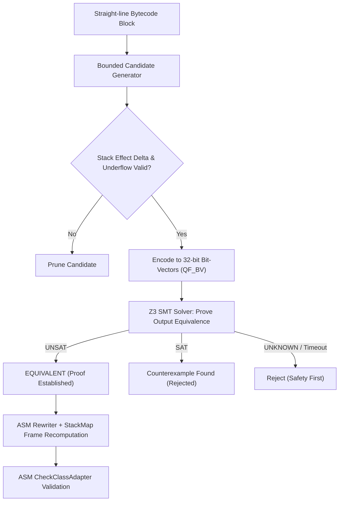

# JVM Bytecode Obfuscator Using Program Equivalence via Superoptimization

A research prototype for transforming compiled Java bytecode into structurally distinct, equivalent instruction sequences using bounded superoptimization and formal SMT verification.

Unlike traditional obfuscators that rely on identifier renaming, string encryption, or opaque predicates, this system replaces linear sequences of bytecode instructions with semantically equivalent alternative sequences discovered through search and proven equivalent using an automated theorem prover (Z3 SMT solver).

---

## Key Features

* **Bounded Superoptimization:** Discovers alternative instruction sequences using bounded combinatorial search and stochastic mutation (STOKE-inspired) rather than static pattern-matching rules.
* **SMT-Based Formal Equivalence Verification:** Encodes JVM integer operations into 32-bit Bit-Vector logic (`QF_BV`) and proves equivalence using the Z3 SMT solver, correctly modeling two's-complement arithmetic, overflow, and bitwise shift masks ($shift\ \&\ 0x1F$).
* **Safe Bytecode Rewriting:** Uses OW2 ASM to splice verified sequences, recomputes valid StackMapTable frames (`COMPUTE_FRAMES`), and verifies classes with `CheckClassAdapter`.
* **Structural Diversity & Multiple Variants:** Generates diverse bytecode variants for the same class guided by configurable objectives (`MIN_SIZE`, `STRUCTURAL_DIVERSITY`, `BALANCED`) and deterministic build seeds (`--seed <long>`).
* **Empirical Validation:** Automated differential testing pipeline executing 10,000+ random inputs and critical boundary values (`Integer.MIN_VALUE`, `Integer.MAX_VALUE`, `-1`, `0`, `1`) in isolated classloaders.

---

## Architecture Overview

```
jvm-superoptimizer/
├── pom.xml
├── README.md
├── IMPLEMENTATION_PLAN.md
├── UPDATE.md
├── .gitignore
│
├── src/
│   ├── main/
│   │   └── java/
│   │       └── com/superopt/
│   │           ├── Main.java                          # CLI entry point
│   │           ├── cli/                               # Command-line parsing & options
│   │           ├── analysis/                          # ASM Tree CFG & BasicBlock analysis
│   │           ├── model/                             # Core data models (IR, Stack, CFG)
│   │           ├── semantics/                         # JVM 32-bit Bit-Vector integer semantics
│   │           ├── optimizer/                         # Bounded candidate search & pruning
│   │           ├── verification/                      # Z3 SMT equivalence checker
│   │           ├── transformation/                    # ASM bytecode rewriter & frame recomputer
│   │           ├── testing/                           # Differential tester & random inputs
│   │           ├── benchmarking/                      # Metrics collector & JSON reporter
│   │           └── config/                            # Optimization configuration
│   │
│   └── test/
│       └── java/
│           └── com/superopt/                          # Comprehensive JUnit 5 test suites
│
├── examples/                                          # Sample input classes for testing
├── benchmarks/                                        # Benchmark configurations & results
└── docs/                                              # In-depth architectural & verification docs
```

---

## Formal Verification Workflow



---

## Implementation Phases

The prototype is engineered through 8 progressive phases:

1. **Bytecode Analyzer & CFG:** ASM Tree parsing, basic block partitioning, control-flow graph construction, and opcode classification.
2. **JVM Instruction Semantics:** Precise 32-bit Bit-Vector model for JVM integer arithmetic, preserving two's-complement overflow and stack effects.
3. **Bounded Superoptimizer:** Search engine with bounded search space, pruning of unbalanced stack states, deduplication, and candidate scoring.
4. **Z3 Equivalence Verification:** Automated equivalence theorem proving, counterexample extraction, and timeout handling.
5. **Bytecode Transformation:** Splicing verified instructions, recomputing stack map frames, and validating classes with `CheckClassAdapter`.
6. **Multiple Equivalent Variants:** Generating distinct candidate pools and selecting by `MIN_SIZE`, `STRUCTURAL_DIVERSITY`, or `BALANCED`.
7. **Build-Time CLI & JAR Pipeline:** Deterministic variant selection via fixed seeds, processing standalone classes and complete JAR archives.
8. **Differential Testing & Benchmarking:** Automated test runner executing 10,000 random inputs and boundary cases, plus performance and size benchmarking.

---

## Command-Line Interface

### 1. Analyze a compiled class
```bash
java -jar target/jvm-superoptimizer.jar analyze input.class
```

### 2. Optimize and transform bytecode
```bash
java -jar target/jvm-superoptimizer.jar optimize input.class --output optimized.class
```

### 3. Generate distinct variants
```bash
java -jar target/jvm-superoptimizer.jar variants input.class --count 5 --output-dir variants/
```

### 4. Deterministic build with random seed
```bash
java -jar target/jvm-superoptimizer.jar optimize input.class --seed 12345 --output optimized.class
```

### 5. Run differential benchmarks
```bash
java -jar target/jvm-superoptimizer.jar benchmark input.class --random-tests 10000 --output report.json
```

---

## Prerequisites & Building

* **JDK:** Java 17 or Java 21 LTS
* **Maven:** Apache Maven 3.8+ (tested with 3.9.9)
* **Z3 Solver:** Embedded multi-platform native bindings via `tools.aqua:z3-turnkey:4.14.1` (no manual native library installation required).

```bash
# Build the project and run all tests
mvn clean package

# Run JaCoCo code coverage report
mvn jacoco:report
```

---

## Research Scope & Soundness Guarantees

* **Semantic Soundness:** Equivalence is established under the documented 32-bit Bit-Vector model. An `UNSAT` result from Z3 provides formal mathematical proof that no 32-bit input vector can produce differing outputs.
* **Safe Fallback:** Any instruction outside the supported integer subset, or any verification query resulting in `UNKNOWN` or timeout, is rejected without modifying the original bytecode.
* **Differential Validation:** Differential testing does not substitute for formal proof, but serves as empirical cross-validation against the live JVM implementation.
